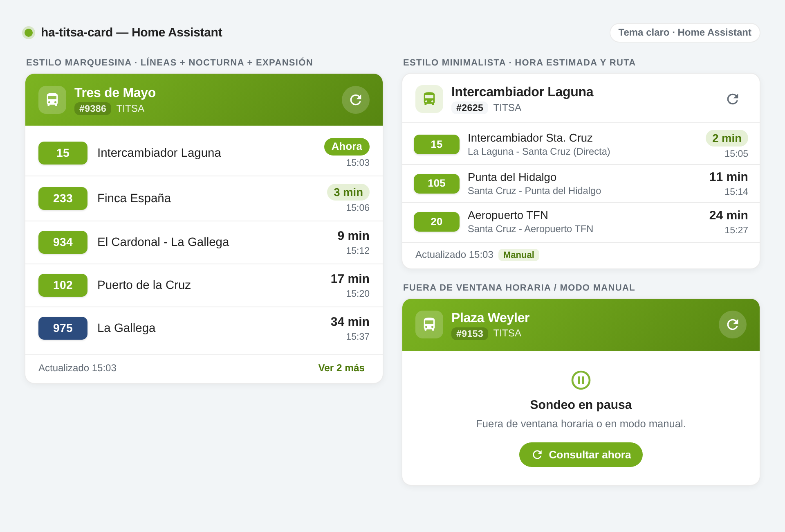
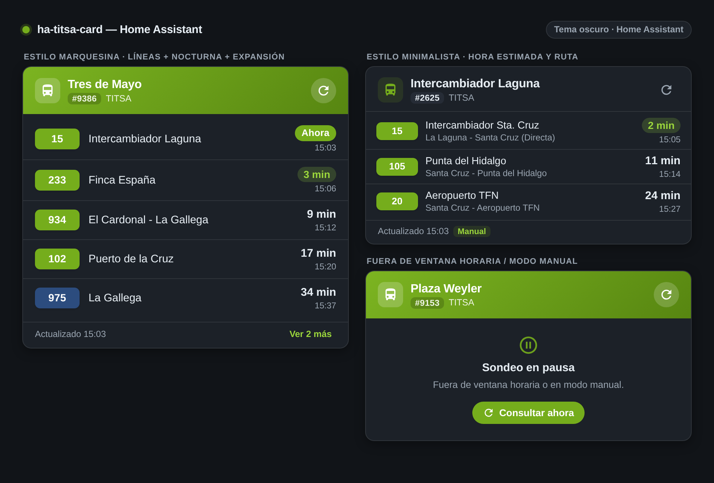

# Tarjeta TITSA para Home Assistant (`ha-titsa-card`)

[](https://github.com/alejandrojara/ha-titsa-card/actions/workflows/ci.yml)
[](https://github.com/alejandrojara/ha-titsa-card/actions/workflows/hacs.yml)
[](LICENSE)

Tarjeta personalizada **no oficial** de Lovelace para **Home Assistant** con diseño estilo **marquesina TITSA** (y estilo **minimalista** nativo) para consultar en tiempo real las próximas guaguas de **TITSA (Tenerife)** junto con la integración [`alejandrojara/ha-titsa`](https://github.com/alejandrojara/ha-titsa).

> [!IMPORTANT]
> **Componente no oficial:** Este proyecto es una tarjeta comunitaria independiente desarrollada por terceros. **No está afiliado, patrocinado, avalado ni soportado oficialmente por Transportes Interurbanos de Tenerife, S.A. (TITSA) ni por el Cabildo Insular de Tenerife.** Para soporte o incidencias técnicas de esta tarjeta utiliza únicamente el [issue tracker de este repositorio](https://github.com/alejandrojara/ha-titsa-card/issues) y nunca los canales de atención al cliente de TITSA.

---

## Vista previa

### Tema claro



### Tema oscuro



---

## Características principales

* **Dos estilos visuales integrados:**
  * **`marquesina` (predeterminado):** cabecera verde TITSA (`#75AD1C`) con código de parada (`#9386`), pastillas de línea, diferenciación automática de **líneas nocturnas (`97x`)** en azul noche y distintivos para llegadas **`Ahora`** e inminentes (`≤ 5 min`).
  * **`minimal`:** cabecera limpia adaptada al tema nativo de Home Assistant (claro y oscuro).
* **Configuración 100 % visual (sin YAML):** editor gráfico nativo (`<ha-form>`) con selector filtrado automáticamente a sensores de la integración `titsa` (compatible tanto con el sensor agregado `Próxima guagua` como con sensores individuales `Línea X`).
* **Cuenta atrás viva en local:** recalcula los minutos localmente cada 15 s a partir de `estimated_arrival` sin generar peticiones extra a `titsa.com`, y soporta tiempos aproximados (`>60 min`) y hora estimada opcional (`HH:MM`).
* **Refresco bajo demanda con detección automática:** descubre automáticamente el botón `button.<parada>_actualizar` del mismo dispositivo (sin depender del idioma ni del `entity_id`). Permite actualizar con un toque en el botón superior, tocando la tarjeta o desde el botón **«Consultar ahora»** cuando el sondeo está en pausa, mostrando un aviso integrado si el *cooldown* de 30 s está activo.
* **Expansión sin recargar:** si hay más guaguas que `max_arrivals`, el enlace **`Ver N más`** despliega el resto sin disparar una nueva consulta.
* **Preparada para vistas por Secciones (*Sections*):** implementa `getGridOptions()` y `getCardSize()`, localización automática en **español e inglés**, modo compacto y filtro opcional de líneas a nivel de tarjeta.
* **Paquete único autocontenido:** un solo archivo ES module (`ha-titsa-card.js`, ~15 KB gzip) sin dependencias externas en tiempo de ejecución.

---

## Requisitos previos

Necesitas tener instalada y configurada la integración comunitaria **[`alejandrojara/ha-titsa`](https://github.com/alejandrojara/ha-titsa)** en tu instancia de Home Assistant.

---

## Instalación

### Mediante HACS (recomendado)

[](https://my.home-assistant.io/redirect/hacs_repository/?owner=alejandrojara&repository=ha-titsa-card&category=plugin)

1. Pulsa el botón superior (o añade `https://github.com/alejandrojara/ha-titsa-card` como repositorio personalizado de categoría **Dashboard** / **Lovelace** en HACS).
2. Instala **TITSA Card**.
3. Recarga el navegador (caché forzada) cuando HACS te lo indique.

### Instalación manual

1. Descarga `ha-titsa-card.js` desde la última [Release](https://github.com/alejandrojara/ha-titsa-card/releases).
2. Cópialo en `<config>/www/ha-titsa-card.js`.
3. Añade el recurso en **Ajustes → Paneles de control → ⋮ → Recursos**:
   * **URL:** `/local/ha-titsa-card.js`
   * **Tipo de recurso:** `Módulo JavaScript`

---

## Configuración

### Editor visual (recomendado)

1. Edita tu panel de Home Assistant y pulsa **Añadir tarjeta**.
2. Busca **`TITSA Bus Stop Card`**.
3. Selecciona tu sensor de parada TITSA y ajusta el estilo (`marquesina` o `minimal`), el número máximo de llegadas, el modo compacto, las líneas a mostrar o la hora estimada (`HH:MM`).

### Configuración en YAML

#### Ejemplo 1: Estilo marquesina completo

```yaml
type: custom:ha-titsa-card
entity: sensor.tres_de_mayo_9386_proxima_guagua
style: marquesina
max_arrivals: 5
show_arrival_time: true
show_footer: true
tap_to_refresh: true
```

#### Ejemplo 2: Estilo minimalista compacto con filtro de líneas y descripción de ruta

```yaml
type: custom:ha-titsa-card
entity: sensor.intercambiador_laguna_2625_proxima_guagua
title: Vuelta a Santa Cruz
style: minimal
compact: true
max_arrivals: 3
lines:
  - "15"
  - "105"
  - "20"
show_arrival_time: true
show_route_name: true
```

### Referencia de opciones

| Opción | Tipo | Predeterminado | Descripción |
| :--- | :--- | :--- | :--- |
| `entity` | `string` | *(obligatoria)* | Entidad `sensor.*` de `ha-titsa` (sensor agregado `Próxima guagua` o sensor individual `Línea X`). |
| `style` | `"marquesina" \| "minimal"` | `"marquesina"` | Estilo visual de la cabecera (verde marquesina TITSA o minimalista nativo). |
| `title` | `string` | `stop_name` | Título personalizado opcional para la parada. |
| `max_arrivals` | `number` (`1`–`12`) | `5` | Número máximo de llegadas visibles antes del botón «Ver N más». |
| `lines` | `string[]` | *(todas)* | Filtro adicional de códigos de línea únicamente en esta tarjeta (p. ej. `["15", "233"]`). |
| `compact` | `boolean` | `false` | Reduce el espaciado vertical para paneles densos o móvil. |
| `show_arrival_time` | `boolean` | `false` | Muestra la hora estimada (`HH:MM`) bajo los minutos restantes. |
| `show_route_name` | `boolean` | `false` | Muestra el nombre completo de la línea bajo el destino. |
| `show_footer` | `boolean` | `true` | Muestra el pie con la hora de última estimación, etiqueta `Manual` y botón de expansión. |
| `tap_to_refresh` | `boolean` | `true` | Permite pulsar cualquier zona libre de la tarjeta para invocar `button.press`. |
| `refresh_entity` | `string` | *(auto)* | Sobrescribe manualmente la entidad `button.*` usada al actualizar (por defecto se detecta por dispositivo o nombre). |

---

## Desarrollo local

```bash
npm ci
npm run typecheck
npm run test
npm run build
```

El paquete compilado se genera en `dist/ha-titsa-card.js`.

---

## Aviso legal

* **Componente no oficial y ausencia de afiliación:** `ha-titsa-card` es software libre e independiente de la comunidad, **no oficial y sin soporte, respaldo ni vinculación comercial o técnica con Transportes Interurbanos de Tenerife, S.A. (TITSA) ni con el Cabildo Insular de Tenerife**. El nombre *TITSA* es una marca registrada de su respectivo titular y se emplea únicamente con fines descriptivos y de interoperabilidad.
* **Exclusión de garantías:** Esta tarjeta se proporciona *«tal cual»* (*as is*), sin garantía de ningún tipo, y depende de los datos expuestos localmente por la integración `ha-titsa` en Home Assistant.

---

## Licencia

Distribuido bajo licencia [MIT](LICENSE).
